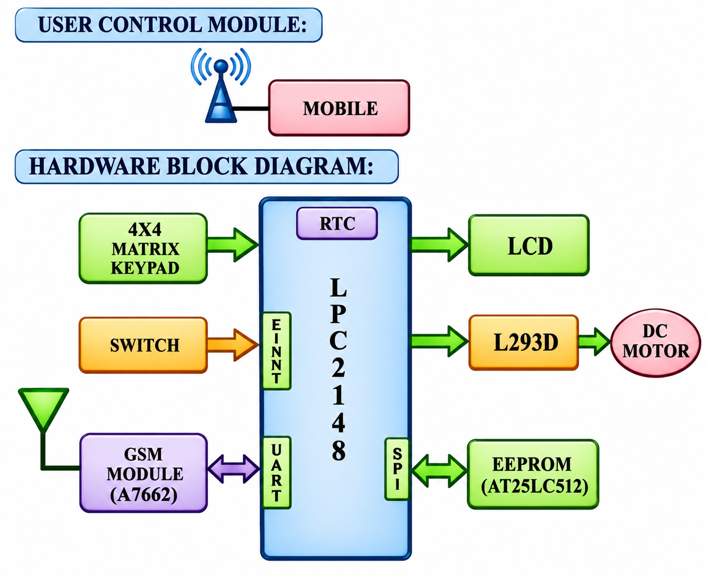

# 🔐 SecureEntry OTP – GSM-Based Two-Step Time-Limited Door Access System

## 📌 Table of Contents

- 📖 Project Overview
- 🎯 Objectives
- 🏗️ Block Diagram
- ⚙️ System Architecture
- 🔌 Hardware Requirements
- 💻 Software Requirements
- 🔄 Working Principle
- ✨ Features
- 📂 Repository Structure
- 🌍 Applications
- 🚀 Future Enhancements

## 📖 Project Overview

**SecureEntry OTP** is a GSM-based two-step authentication door access control system designed to provide secure and time-limited access to authorized users.

The system uses GSM communication to send a One-Time Password (OTP) to the registered mobile number. The user must enter the received OTP through a keypad to gain access to the door.

The OTP is valid only for a limited period, providing an additional layer of security.

The system integrates a microcontroller, GSM module, LCD display, keypad, Real-Time Clock (RTC), EEPROM, and door control mechanism to provide reliable and controlled access.

## 🎯 Objectives

- 🔐 To develop a secure door access control system using Embedded C.
- 📱 To implement two-step authentication for door security.
- 🔑 To generate and verify One-Time Passwords (OTP).
- 📩 To send OTP messages through GSM communication.
- ⏱️ To provide time-limited OTP validation using RTC.
- 🚫 To prevent unauthorized access through OTP verification.
- 🛡️ To improve security and reliability in door access systems.

## 🏗️ Block Diagram

## ⚙️ System Architecture

The system architecture consists of the following modules:

| Module | Function |
|---|---|
| 🧠 Microcontroller | Controls the complete system operation |
| 📱 GSM Module | Sends OTP messages to the registered mobile number |
| 🔢 Keypad | Allows users to enter the received OTP |
| 🖥️ LCD Display | Displays system messages and access status |
| ⏰ RTC Module | Maintains time information for OTP validation |
| 💾 EEPROM | Provides non-volatile data storage |
| 🚪 Door Control Unit | Controls door locking and unlocking |

## 🔌 Hardware Requirements

| Component | Purpose |
|---|---|
| 🧠 Microcontroller Board | Main control unit |
| 📡 GSM Module | OTP message communication |
| 🔢 4×4 Keypad | OTP input |
| 🖥️ LCD Display | User interaction |
| ⏰ RTC Module | Time management |
| 💾 SPI EEPROM | Non-volatile storage |
| 🔒 Door Lock Mechanism | Door access control |
| 🔋 Power Supply | System power |

## 💻 Software Requirements

| Software | Purpose |
|---|---|
| 💻 Embedded C | Programming language |
| 🛠️ Keil µVision | Code development and compilation |
| ⚡ Flash Magic | Microcontroller programming |
| 🔄 UART Communication | Serial communication with GSM |

## 🔄 Working Principle

The system operates through the following sequence:

1. ⚡ **System Initialization:** The microcontroller initializes all interfaced peripherals.
2. 🚪 **Access Request:** The user initiates a door access request.
3. 🔑 **OTP Generation:** The system generates a One-Time Password.
4. 📩 **OTP Transmission:** The GSM module sends the OTP to the registered mobile number.
5. 📲 **User Authentication:** The user receives the OTP and enters it through the keypad.
6. 🔍 **OTP Verification:** The microcontroller verifies the entered OTP.
7. ⏱️ **Time Validation:** The RTC is used to check whether the OTP is within its validity period.
8. ✅ **Access Granted:** If the OTP is correct and valid, the door is unlocked.
9. ❌ **Access Denied:** If the OTP is incorrect or expired, the door remains locked.

## ✨ Features

- 🔐 GSM-based OTP authentication.
- 📱 Two-step authentication.
- ⏳ Time-limited OTP validation.
- 🔢 Keypad-based password entry.
- 🖥️ LCD-based user interaction.
- ⏰ RTC-based time management.
- 💾 EEPROM data storage.
- 🚪 Controlled door locking and unlocking.
- 🛡️ Protection against unauthorized access.

## 📂 Repository Structure

SecureEntry-OTP/
│
├── delay.c
├── delay.h
├── gsm.c
├── gsm.h
├── keypad.c
├── keypad.h
├── lcd.c
├── lcd.h
├── uart.c
├── uart.h
├── spi.c
├── spi.h
├── spi_eeprom.c
├── spi_eeprom.h
├── rtc.c
├── rtc.h
├── otp.c
├── otp.h
├── user.c
├── user.h
├── door.c
├── door.h
├── switch.c
├── switch.h
├── eint.c
├── eint.h
├── defines.h
├── types.h
├── projectmain.c
├── system_block_diagram.png
│
└── README.md
## 🌍 Applications

- 🏠 Residential door security systems.
- 🏢 Office access control systems.
- 🔬 Restricted-area security.
- 🏫 Laboratories and institutional access control.
- 🔒 Electronic security systems.

## 🚀 Future Enhancements

- 🌐 Integration with IoT-based remote monitoring.
- 📲 Mobile application for access management.
- 👆 Biometric authentication.
- 📊 Access attempt logging and monitoring.
- 🔐 Enhanced OTP generation and security mechanisms.

## 👤 Author

**Bhavya Palloli**

Electronics and Communication Engineering (ECE)

**Technologies:** Embedded C | ARM7 | GSM | UART | RTC | SPI EEPROM (AT25LC512) | LCD Interfacing | 4×4 Keypad Interfacing | External Interrupts | GSM AT Commands | OTP Authentication | L293D Motor Driver | DC Motor Control 
